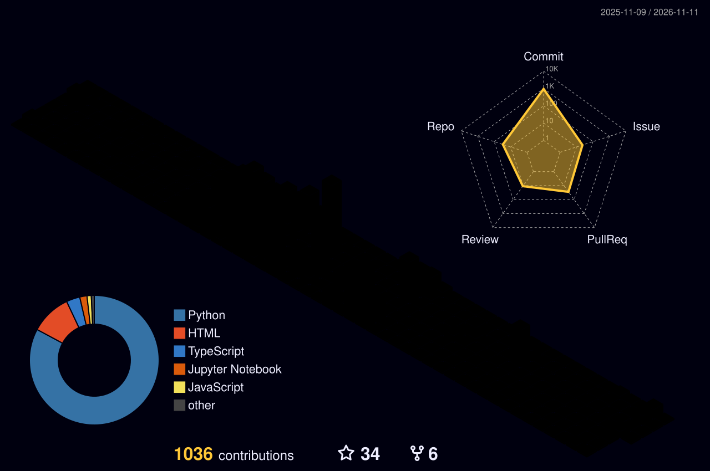

<!-- HEADER SECTION -->
<table width="100%">
  <tr>
    <td align="left" width="80" valign="top">
      
    </td>
    <td align="left" valign="top" style="padding-left:15px;">
      <h2 style="margin:0; background: linear-gradient(120deg, #58a6ff, #bc8cff); -webkit-background-clip: text; -webkit-text-fill-color: transparent;">Deepan Chandrasekaran</h2>
      
@deepanmpc · KL University · Vaddeswaram · Batch 2027

      

       Final year <b>CS + AI</b> engineer building <b>LaRa (Anaavi)</b> — a low-cost adaptive robotic-AI therapy companion for neurodivergent children. CGPA 9.15 · Oracle GenAI · NVIDIA DLI
      

      

        
        
        
        
        
        
        
      

    </td>
  </tr>
</table>

 

<!-- PORTFOLIO BANNER -->
<a href="https://deepanmpc.github.io/PORTFOLIO/" style="text-decoration: none;">
  <table width="100%" bgcolor="#0d1117" style="border: 1.5px solid #30363d; border-radius: 16px; background: linear-gradient(135deg, #0d1117 0%, #161b22 100%); overflow: hidden; box-shadow: 0 4px 15px rgba(88, 166, 255, 0.15);">
    <tr>
      <td align="left" style="padding: 20px; border-left: 6px solid #58a6ff;">
        
EXPLORE MY PORTFOLIO ✨

        
Interactive projects, technical journey, and creative insights.

      </td>
      <td align="right" style="padding: 20px;">
        
Visit Site

      </td>
    </tr>
  </table>
</a>

  
  
  

 

<!-- STATS CARDS WITH COLOUR THEME -->
<table width="100%" bgcolor="#0d1117" style="border: 1px solid #30363d; border-collapse: collapse; border-radius: 12px; overflow: hidden;">
  <!-- ROW 1 -->
  <tr>
    <td align="center" style="padding: 15px; border: 1px solid #30363d; border-top: 3px solid #58a6ff;">
      
9.15

      
CGPA

    </td>
    <td align="center" style="padding: 15px; border: 1px solid #30363d; border-top: 3px solid #3fb950;">
      
3rd

      
RAMPAGE V26

    </td>
    <td align="center" style="padding: 15px; border: 1px solid #30363d; border-top: 3px solid #ffa657;">
      
99.8%

      
ISL Accuracy

    </td>
  </tr>
  <!-- ROW 2 -->
  <tr>
    <td align="center" style="padding: 15px; border: 1px solid #30363d; border-top: 3px solid #bc8cff;">
      
10★

      
SMART-SEARCH

    </td>
    <td align="center" style="padding: 15px; border: 1px solid #30363d; border-top: 3px solid #ff7b72;">
      
50%↑

      
Resume Speed

    </td>
    <td align="center" style="padding: 15px; border: 1px solid #30363d; border-top: 3px solid #e6edf3;">
      
1,043

      
Yearly Contribs

    </td>
  </tr>
</table>
 
<!-- CONTRIBUTION LANDSCAPE -->

  Contribution landscape · 2025–2026

<picture>
  <source media="(prefers-color-scheme: dark)"  srcset="https://raw.githubusercontent.com/deepanmpc/deepanmpc/main/profile-3d-contrib/profile-night-rainbow.svg" />
  <source media="(prefers-color-scheme: light)" srcset="https://raw.githubusercontent.com/deepanmpc/deepanmpc/main/profile-3d-contrib/profile-green-animate.svg" />
  
</picture>
 
<!-- FEATURED PROJECTS GRID -->

   Featured projects

<table width="100%" cellpadding="0" cellspacing="0" border="0">
  <!-- PROJECT 1 -->
  <tr>
    <td style="padding-bottom: 15px;">
      <table width="100%" bgcolor="#161b22" style="border: 1px solid #30363d; border-radius: 12px; border-left: 5px solid #bc8cff; box-shadow: 0 4px 10px rgba(0,0,0,0.3);">
        <tr>
          <td style="padding: 20px;">
            
<a href="https://github.com/deepanmpc/Anaavi_Neurodott" style="color:#bc8cff; text-decoration:none;">001 — LaRa · NeuroDott</a>

            
Low-cost adaptive robotic-AI therapy companion for neurodiverse children and adults with neurological conditions. Real-time speech, emotion modeling, deterministic therapeutic state control, and offline-safe RAG responses between clinical sessions.

            

                  
            

          </td>
        </tr>
      </table>
    </td>
  </tr>
  <!-- PROJECT 2 -->
  <tr>
    <td style="padding-bottom: 15px;">
      <table width="100%" bgcolor="#161b22" style="border: 1px solid #30363d; border-radius: 12px; border-left: 5px solid #58a6ff; box-shadow: 0 4px 10px rgba(0,0,0,0.3);">
        <tr>
          <td style="padding: 20px;">
            
<a href="https://github.com/deepanmpc/Self_DrivingCar_RL" style="color:#58a6ff; text-decoration:none;">002 — Self-Driving Car RL</a>

            
End-to-end PPO driving agent on MetaDrive with an 8-signal observation stack, custom reward shaping, Gymnasium wrappers, TensorBoard training, and a live actor–critic activation visualizer.

            

                  
            

          </td>
        </tr>
      </table>
    </td>
  </tr>
  <!-- PROJECT 3 -->
  <tr>
    <td style="padding-bottom: 15px;">
      <table width="100%" bgcolor="#161b22" style="border: 1px solid #30363d; border-radius: 12px; border-left: 5px solid #3fb950; box-shadow: 0 4px 10px rgba(0,0,0,0.3);">
        <tr>
          <td style="padding: 20px;">
            
<a href="https://github.com/deepanmpc/SMART-SEARCH" style="color:#3fb950; text-decoration:none;">003 — Search Wizard · 10★</a>

            
Natural-language local search across images, video, audio, PDFs, and code — Gemini multimodal embeddings with sub-400ms retrieval over 50K+ files. Available for macOS, Windows, and Linux.

            

                 
            

          </td>
        </tr>
      </table>
    </td>
  </tr>
  <!-- PROJECT 4 -->
  <tr>
    <td style="padding-bottom: 15px;">
      <table width="100%" bgcolor="#161b22" style="border: 1px solid #30363d; border-radius: 12px; border-left: 5px solid #ffa657; box-shadow: 0 4px 10px rgba(0,0,0,0.3);">
        <tr>
          <td style="padding: 20px;">
            
<a href="https://github.com/deepanmpc/adversarial-defense-anti-spoofing" style="color:#ffa657; text-decoration:none;">004 — ClaimShield</a>

            
5-layer adversarial defense and anti-spoofing engine for parametric insurance — behavioral coherence, LightGBM sensor fusion, Louvain ring detection, computer vision, and LLM audit trails. Guidewire DEVTrails 2026 · Phase 2.

            

                 
            

          </td>
        </tr>
      </table>
    </td>
  </tr>
  <!-- PROJECT 5 -->
  <tr>
    <td style="padding-bottom: 15px;">
      <table width="100%" bgcolor="#161b22" style="border: 1px solid #30363d; border-radius: 12px; border-left: 5px solid #ff7b72; box-shadow: 0 4px 10px rgba(0,0,0,0.3);">
        <tr>
          <td style="padding: 20px;">
            
<a href="https://github.com/deepanmpc/FoodForDevs" style="color:#ff7b72; text-decoration:none;">005 — Food For Devs · 4★</a>

            
Terminal-native MCP food ordering bridge — order from Zomato inside Claude Desktop, Claude Code, Gemini CLI, Codex, or OpenCode in under 30 seconds without breaking flow state.

            

                 
            

          </td>
        </tr>
      </table>
    </td>
  </tr>
  <!-- PROJECT 6 -->
  <tr>
    <td style="padding-bottom: 15px;">
      <table width="100%" bgcolor="#161b22" style="border: 1px solid #30363d; border-radius: 12px; border-left: 5px solid #bc8cff; box-shadow: 0 4px 10px rgba(0,0,0,0.3);">
        <tr>
          <td style="padding: 20px;">
            
<a href="https://github.com/deepanmpc/Ahoum_Assignment" style="color:#bc8cff; text-decoration:none;">006 — Ahoum Facet Engine</a>

            
Conversation-to-facet scoring pipeline with hybrid semantic + keyword retrieval, Qwen/Ollama batched scoring, structural validation, evidence grounding, safe abstentions, and 133 tests.

            

                 
            

          </td>
        </tr>
      </table>
    </td>
  </tr>
  <!-- PROJECT 7 -->
  <tr>
    <td style="padding-bottom: 15px;">
      <table width="100%" bgcolor="#161b22" style="border: 1px solid #30363d; border-radius: 12px; border-left: 5px solid #58a6ff; box-shadow: 0 4px 10px rgba(0,0,0,0.3);">
        <tr>
          <td style="padding: 20px;">
            
<a href="https://github.com/deepanmpc/LOVE_PREDICT_ML_MODEL" style="color:#58a6ff; text-decoration:none;">007 — LOVE PREDICT</a>

            
Relationship-compatibility classifier at <b>94.5% accuracy</b> with XGBoost (88.6% for Random Forest), a 30-question web quiz, and a Flask prediction API.

            

                 
            

          </td>
        </tr>
      </table>
    </td>
  </tr>
  <!-- PROJECT 8 -->
  <tr>
    <td style="padding-bottom: 15px;">
      <table width="100%" bgcolor="#161b22" style="border: 1px solid #30363d; border-radius: 12px; border-left: 5px solid #3fb950; box-shadow: 0 4px 10px rgba(0,0,0,0.3);">
        <tr>
          <td style="padding: 20px;">
            
<a href="https://github.com/deepanmpc/Placement-Agent-Automation" style="color:#3fb950; text-decoration:none;">008 — Placement Agent</a>

            
Placement intelligence dashboard aggregating GitHub, LeetCode, Codeforces, and CodeChef profiles with candidate scoring, PostgreSQL persistence, and a Qdrant-backed RAG service.

            

                 
            

          </td>
        </tr>
      </table>
    </td>
  </tr>
</table>

 

<!-- MORE PROJECTS -->

   More builds & experiments

<table width="100%" cellpadding="0" cellspacing="0" border="0">
  <tr>
    <td width="33%" valign="top" style="padding: 0 8px 8px 0;">
      <table width="100%" bgcolor="#161b22" style="border:1px solid #30363d; border-radius:10px;">
        <tr><td style="padding:14px;">
          
<a href="https://github.com/deepanmpc/COWORK_AGENT_DESKTOP_AUTOMATION-COMPUTER_USE-" style="color:#ff7b72; text-decoration:none;">Cowork Agent</a>

          
Autonomous macOS desktop agent that sees, plans, acts, and verifies.

          
Python · OmniParser · LLM

        </td></tr>
      </table>
    </td>
    <td width="33%" valign="top" style="padding: 0 4px 8px 4px;">
      <table width="100%" bgcolor="#161b22" style="border:1px solid #30363d; border-radius:10px;">
        <tr><td style="padding:14px;">
          
<a href="https://github.com/deepanmpc/ResumeAnalyse_RAG-Architecture" style="color:#ffa657; text-decoration:none;">ResumeAnalyse</a>

          
RAG resume-to-JD matching that cuts screening effort by 50%.

          
Transformers · ChromaDB · Mistral

        </td></tr>
      </table>
    </td>
    <td width="33%" valign="top" style="padding: 0 0 8px 8px;">
      <table width="100%" bgcolor="#161b22" style="border:1px solid #30363d; border-radius:10px;">
        <tr><td style="padding:14px;">
          
<a href="https://github.com/deepanmpc/ISL_SIGNLANG_CNN" style="color:#58a6ff; text-decoration:none;">SignSpeak AI</a>

          
Indian Sign Language recognition at 99.8% and 45 FPS edge inference.

          
PyTorch · CNN · OpenCV

        </td></tr>
      </table>
    </td>
  </tr>
  <tr>
    <td width="33%" valign="top" style="padding: 0 8px 8px 0;">
      <table width="100%" bgcolor="#161b22" style="border:1px solid #30363d; border-radius:10px;">
        <tr><td style="padding:14px;">
          
<a href="https://github.com/deepanmpc/3D-shirt_customizer" style="color:#bc8cff; text-decoration:none;">3D Apparel Customizer</a>

          
Real-time 3D shirt design with Gemini-generated textures and logos.

          
React · Three.js · Express

        </td></tr>
      </table>
    </td>
    <td width="33%" valign="top" style="padding: 0 4px 8px 4px;">
      <table width="100%" bgcolor="#161b22" style="border:1px solid #30363d; border-radius:10px;">
        <tr><td style="padding:14px;">
          
<a href="https://github.com/deepanmpc/FALL_DETECTION_VRSU" style="color:#ff7b72; text-decoration:none;">Fall Detection</a>

          
MediaPipe pose monitoring with lean-angle thresholds and multi-state alerts.

          
Python · MediaPipe · OpenCV

        </td></tr>
      </table>
    </td>
    <td width="33%" valign="top" style="padding: 0 0 8px 8px;">
      <table width="100%" bgcolor="#161b22" style="border:1px solid #30363d; border-radius:10px;">
        <tr><td style="padding:14px;">
          
<a href="https://github.com/deepanmpc/LLM_Scratch" style="color:#ffa657; text-decoration:none;">LLM From Scratch</a>

          
Educational repo covering the building blocks of modern language models.

          
Python · Jupyter

        </td></tr>
      </table>
    </td>
  </tr>
  <tr>
    <td width="33%" valign="top" style="padding: 0 8px 8px 0;">
      <table width="100%" bgcolor="#161b22" style="border:1px solid #30363d; border-radius:10px;">
        <tr><td style="padding:14px;">
          
<a href="https://github.com/deepanmpc/key-based-medical-image-watermarking" style="color:#58a6ff; text-decoration:none;">Medical Image Watermarking</a>

          
RSA-signature watermarking in image LSBs with key generation and verification.

          
Python · RSA · Cryptography

        </td></tr>
      </table>
    </td>
    <td width="33%" valign="top" style="padding: 0 4px 8px 4px;">
      <table width="100%" bgcolor="#161b22" style="border:1px solid #30363d; border-radius:10px;">
        <tr><td style="padding:14px;">
          
<a href="https://github.com/deepanmpc/sala_college" style="color:#3fb950; text-decoration:none;">Sala College</a>

          
Full-stack college discovery, comparison, predictor, and Q&amp;A platform.

          
React · Express · PostgreSQL

        </td></tr>
      </table>
    </td>
    <td width="33%" valign="top" style="padding: 0 0 8px 8px;">
      <table width="100%" bgcolor="#161b22" style="border:1px solid #30363d; border-radius:10px;">
        <tr><td style="padding:14px;">
          
<a href="https://github.com/deepanmpc/deveats-ai" style="color:#bc8cff; text-decoration:none;">DevEats AI</a>

          
Local-first CLI food discovery and ordering agent with slash commands.

          
Node.js · CLI · AI

        </td></tr>
      </table>
    </td>
  </tr>
</table>

 

<!-- STACK & ACTIVITY -->

   Stack & activity

<table width="100%" border="0" cellpadding="0" cellspacing="0">
  <tr>
    <td width="55%" valign="top" style="padding-right:10px;">
      <table width="100%" bgcolor="#161b22" style="border:1px solid #30363d; border-radius:12px;">
        <tr>
          <td style="padding:15px;">
            
 Top Languages

            
          </td>
        </tr>
      </table>
    </td>
    <td width="45%" valign="top">
      <table width="100%" bgcolor="#161b22" style="border:1px solid #30363d; border-radius:12px; border-top: 3px solid #ffa657;">
        <tr>
          <td align="center" style="padding:15px;">
            
 Longest Streak

            52
            
DAYS · FEB–APR 2026

          </td>
        </tr>
      </table>
      <table width="100%" bgcolor="#161b22" style="border:1px solid #30363d; border-radius:12px; margin-top:12px; border-top: 3px solid #3fb950;">
        <tr>
          <td align="center" style="padding:15px;">
            
 Public Repos

            54
            
OPEN SOURCE BUILDS

          </td>
        </tr>
      </table>
      <table width="100%" bgcolor="#161b22" style="border:1px solid #30363d; border-radius:12px; margin-top:12px; border-top: 3px solid #bc8cff;">
        <tr>
          <td style="padding:15px;">
            
 Certs & Hackathons

            

               <b>Oracle</b> GenAI Professional 
               <b>NVIDIA</b> Deep Learning Institute 
               <b>Guidewire</b> DEVTrails 2026 · Phase 2 
               <b>RAMPAGE V26</b> · 3rd Place
            

          </td>
        </tr>
      </table>
    </td>
  </tr>
</table>

 

<!-- FULL METRICS -->

  
Full GitHub metrics

   
  

 

  <b style="color:#58a6ff;">Deepan Chandrasekaran</b> · Karur, India · Building at the intersection of AI, robotics, and human care. 
  <a href="https://deepanmpc.github.io/PORTFOLIO/" style="color:#58a6ff; text-decoration:none;">Portfolio</a> ·
  <a href="https://github.com/deepanmpc" style="color:#58a6ff; text-decoration:none;">GitHub</a> ·
  <a href="https://linkedin.com/in/deepanmpc" style="color:#58a6ff; text-decoration:none;">LinkedIn</a>

